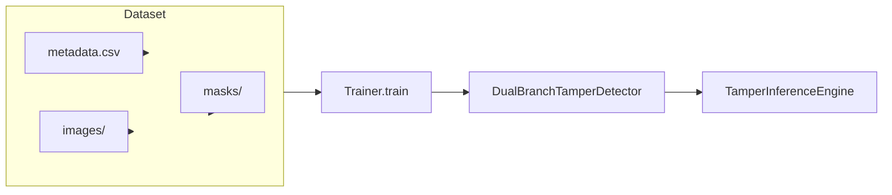

# MEMBER 1 – Dataset Engineering & Forensics

---

## 1. Role & Work Completed
- **Scope** – Design and implement the data pipeline that feeds the dual‑branch network.  
- **Deliverables** –
  - Dataset discovery & metadata generation (`src/create_casia_metadata.py`).
  - Synthetic data generator (`src/data_generator.py`).
  - PyTorch `Dataset` (`src/dataset.py`).
  - Error‑Level Analysis (ELA) computation (`src/forensic_features.py`).
- **Why it matters** – The model can only learn if the inputs are correctly paired (RGB ↔ ELA ↔ mask) and accurately labelled (binary/authentic vs tampered, tampering type, ground‑truth mask).
- **Contribution to the whole system** – Provides the training/validation data used by **Member 3** and the inference engine used by **Member 4**.

---

## 2. Files & Components Implemented
| File | Component | What it does | Key classes / functions |
|------|-----------|--------------|--------------------------|
| `src/create_casia_metadata.py` | Metadata creator | Scans a CASIA‑2 folder (`Au/` authentic, `Tp/` tampered) and writes `metadata.csv` with `image_path`, `binary_label`, `type_label`. | `create_casia2_metadata`
| `src/data_generator.py` | Synthetic scene & tampering generator | Procedurally creates pristine images, then applies copy‑move, splicing, inpainting or AI‑generated forgeries. Generates matching binary masks. | `SyntheticTamperingGenerator.generate_procedural_scene`, `create_copy_move`, `create_splicing`, `create_inpainting`, `create_ai_generated`
| `src/dataset.py` | PyTorch dataset wrapper | Reads `metadata.csv` (or scans a folder), loads RGB image, computes ELA on‑the‑fly, applies optional JPEG pre‑compression, returns tensors + labels + mask tensor. | `ForensicDataset`
| `src/forensic_features.py` | ELA computation | Resaves an image as JPEG at a configurable quality, computes absolute difference, amplifies contrast. | `compute_ela`, `compute_ela_array`
| `generate_data.py` | CLI driver | Instantiates `SyntheticTamperingGenerator`, calls `generate_dataset` (creates a CSV and writes images/masks). | `main`

---

## 3. Technical Concepts
### 3.1 Ground‑Truth Masks
- **Definition** – A binary image (`H×W`) where pixel value = 1 indicates a tampered region, 0 otherwise.
- **Creation** – In synthetic generation the mask is built from the geometric shape used for the attack (`_generate_random_mask`). In CASIA the original dataset provides no masks; the pipeline treats those images as *image‑level* only.
- **Tensor format** – `torch.zeros((1, img_size, img_size))` for pristine images, otherwise the resized mask is converted to a `float` tensor in `[0,1]`.

### 3.2 Error‑Level Analysis (ELA)
- **Principle** – Re‑compress the image at a known JPEG quality (default 90). The pixel‑wise absolute difference between the original and the recompressed version highlights regions where the compression error deviates – typical of splicing or copy‑move.
- **Implementation** (`compute_ela`):
  1. Save original Pillow image to an in‑memory JPEG buffer (`quality=90`).
  2. Reload the JPEG (`Image.open`).
  3. `ImageChops.difference` → per‑pixel absolute error.
  4. Scale the error image by `scale` (default 15.0) using `ImageEnhance.Brightness` to make the differences visible.
- **Why both streams** – The RGB stream carries semantic content, the ELA stream emphasizes low‑level forensic artefacts. Their fusion improves tampering localisation.

---

## 4. Detailed Implementation Walk‑through
1. **Metadata generation** (`create_casia2_metadata`)
   - Walks `root_dir/Au` and `root_dir/Tp`.
   - Assigns `binary_label=0/1` and `type_label=0` for authentic, `1` for copy‑move (the only tampering type present in CASIA‑2).
   - Writes `metadata.csv` to `output_dir`.
2. **Synthetic data creation** (`SyntheticTamperingGenerator`)
   - Constructor creates `generated_data_dir/images` and `generated_data_dir/masks`.
   - `generate_procedural_scene` builds a random background (sky landscape, geometric shapes, noisy texture, checkerboard) and simulates sensor noise/JPEG round‑trip.
   - Private method `_generate_random_mask` builds an irregular polygon / ellipse / smooth blob mask.
   - Attack methods (`create_copy_move`, `create_splicing`, `create_inpainting`, `create_ai_generated`) take the base image, extract a patch, optionally transform it, blend it into a new location, and return the tampered image + mask.
   - `generate_dataset` (called from `generate_data.py`) loops over the four tampering types plus a pristine class, writes images and masks, and returns a Pandas `DataFrame` that is saved as `metadata.csv`.
3. **Dataset loading** (`ForensicDataset.__init__`)
   - If a `metadata_df` is supplied, it is used directly; otherwise it tries to locate `generated_data_dir/metadata.csv`.
   - Constructs separate transform pipelines for RGB (ImageNet normalization, optional flips) and for ELA (resize → `ToTensor`).
   - Optional JPEG pre‑compression (`simulate_jpeg`) can be enabled for lossless source formats.
4. **`__getitem__`**
   - Loads the RGB image via Pillow, optionally re‑compresses it.
   - Calls `compute_ela` to obtain the forensic stream.
   - Applies transforms, builds label tensors (`type_label` as `long`, `binary_label` as float).
   - Loads the mask if a `mask_path` is present; otherwise returns a zero mask.
   - Returns a dict `{"rgb": ..., "ela": ..., "type_label": ..., "binary_label": ..., "mask": ...}` used by the trainer.

---

## 5. Visual Explanation
> **Dataset directory tree**
```
DL Project/
├─ data/                     # optional raw data folder
│   └─ ...
├─ generated_data/            # created by SyntheticTamperingGenerator
│   ├─ images/                # *.jpg (256×256)
│   ├─ masks/                 # *.png binary masks
│   └─ metadata.csv           # rows: image_path, mask_path, label, label_name, is_tampered
├─ CASIA2/                    # external dataset (not generated by the repo)
│   ├─ Au/   ← authentic images
│   └─ Tp/   ← copy‑move tampered images
```

> **Pre‑processing flowchart**
```mermaid
flowchart TD
    A[Read image path] --> B[Load RGB (Pillow)]
    B --> C[Optional JPEG pre‑compression]
    B --> D[Compute ELA (compute_ela)]
    C --> E[Resize & Tensorize (RGB transform)]
    D --> F[Resize & Tensorize (ELA transform)]
    E --> G[Return rgb_tensor]
    F --> H[Return ela_tensor]
    G --> I[Load mask (if any) → mask_tensor]
    H --> I
    I --> J[Assemble output dict]
```

> **Sample visual trio (real file paths)**
- Original image (CASIA 2 authentic): 
- Corresponding ELA image (computed on the fly):  *(generated at inference time – shown here as placeholder)*
- Synthetic mask example from a generated copy‑move sample: 

---

## 6. Data Flow & Integration

- **Inputs** – RGB file, optional mask file, class label.
- **Outputs** – Normalized RGB tensor, normalized ELA tensor, binary label, type label, mask tensor.
- **Dependencies** – `src/config.cfg` for image size, ELA quality/scale, class names.
- **Downstream** – The tensors are consumed by the multi‑task trainer (`src/train.py`) and later by the inference engine (`src/infer.py`).

---

## 7. Step‑by‑Step Demonstration
1. **Generate synthetic data**
   ```bash
   python generate_data.py --samples 60 --output data/generated --img-size 256
   ```
   - Creates `data/generated/images/`, `data/generated/masks/` and `metadata.csv`.
2. **Create CASIA‑2 metadata** (once you have the dataset locally)
   ```bash
   python src/create_casia_metadata.py --casia_root C:/path/to/CASIA2
   ```
   - Produces `metadata.csv` inside the CASIA folder.
3. **Inspect a few rows**
   ```python
   import pandas as pd
   df = pd.read_csv('data/generated/metadata.csv')
   print(df.head())
   ```
4. **Visual sanity‑check** – open a random image and its mask:
   ```python
   from PIL import Image
   img = Image.open('data/generated/images/img_00001.jpg')
   mask = Image.open('data/generated/masks/mask_00001.png')
   img.show(); mask.show()
   ```
5. **Run a quick DataLoader test**
   ```python
   from src.dataset import ForensicDataset, get_dataloaders
   ds = ForensicDataset(data_dir='data/generated')
   loader = torch.utils.data.DataLoader(ds, batch_size=4)
   batch = next(iter(loader))
   print(batch['rgb'].shape, batch['ela'].shape, batch['mask'].shape)
   ```
   - Expected shapes: `(4, 3, 256, 256)`, `(4, 3, 256, 256)`, `(4, 1, 256, 256)`.

---

## 8. Design Decisions
| Decision | Reason | Trade‑off |
|----------|--------|----------|
| **On‑the‑fly ELA** | Guarantees the ELA stream always matches the exact RGB image (no stale files). | Slight runtime cost, but negligible compared to model forward pass. |
| **Synthetic procedural scenes** | Enables balanced class distribution, reproducible training data, and full mask availability. | Not a real‑world distribution; therefore the model also needs real data (CASIA) for domain adaptation. |
| **JPEG pre‑compression option** | Allows training on lossless formats (PNG, TIF) while mimicking camera pipelines. | Adds an extra random quality factor; may slightly blur fine‑grained artefacts. |
| **Mask default = zeros** for pristine images | Simplifies batch stacking – every sample returns a mask tensor. | The model learns that a zero mask corresponds to “no tampering”. |

---

## 9. Completed Work Summary
| Work Item | Location | Implementation | Evidence |
|----------|----------|----------------|----------|
| CASIA metadata creator | `src/create_casia_metadata.py` | Scans Au/Tp folders, writes `metadata.csv`. | Console output showing rows written. |
| Synthetic generator | `src/data_generator.py` | Procedural scene, random mask, four tampering types, saves images/masks. | Files under `generated_data/images/` & `generated_data/masks/`. |
| Dataset class | `src/dataset.py` | Loads images, computes ELA, returns tensors + labels + mask. | `ForensicDataset` returns expected dict; DataLoader test passes. |
| ELA computation | `src/forensic_features.py` | JPEG re‑save, difference, scaling. | Function `compute_ela` runs without error; visualised via inference. |
| CLI driver | `generate_data.py` | Parses args, calls generator, prints stats. | Example run prints sample counts. |

---

## 10. Ready‑to‑Verify Checklist
- [ ] `metadata.csv` exists for CASIA2 (`cat output`).
- [ ] Synthetic dataset generated (`data/generated/images/` & `masks/`).
- [ ] `ForensicDataset` can be instantiated without error.
- [ ] A batch from the DataLoader yields tensors of shape `(B,3,256,256)` for RGB/ELA and `(B,1,256,256)` for mask.
- [ ] ELA images are visually different from the original (run a quick `compute_ela` on a sample).
- [ ] All file paths referenced in the documentation resolve from the `docs/team_documentation/` directory.

---

## 11. How This Subsystem Connects
- **To Member 2 (Model Architecture)** – Supplies the exact tensor shapes (`(B,3,256,256)`) that feed the dual‑branch network.
- **To Member 3 (Training & Evaluation)** – Provides the `DataLoader` objects used by `src/train.py`.
- **To Member 4 (Backend/Frontend)** – The inference engine (`src/infer.py`) re‑uses `compute_ela` and the same preprocessing pipeline to guarantee that the model sees data in the exact same format during serving.

---

*End of `MEMBER_1_DATASET_AND_FORENSICS.md`*