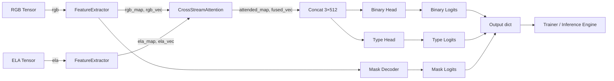

# MEMBER 2 – Model Architecture & Development

---

## 1. Role & Work Completed
- **Scope** – Design, implement and test the dual‑branch deep‑learning model that jointly processes the raw RGB image and its Error‑Level Analysis (ELA) representation.
- **Deliverables** –
  - `src/models/dual_branch_net.py` – full network definition.
  - Integration of the model into the training pipeline (`src/train.py`) and inference engine (`src/infer.py`).
- **Why it matters** – This is the core of *DeepVision Forensics*: it extracts forensic cues from both visual content and compression artefacts, fuses them, and produces three outputs (binary authenticity, tampering‑type attribution, pixel‑wise mask).
- **Contribution to the whole system** – Consumes the tensors produced by **Member 1** and supplies predictions consumed by **Member 3** (training loss) and **Member 4** (API / UI).

---

## 2. Files & Components Implemented
| File | Component | What it does | Important classes / functions |
|------|-----------|--------------|-------------------------------|
| `src/models/dual_branch_net.py` | Network definition | Implements the two‑stream ResNet‑34 backbone, cross‑stream attention fusion, three task‑specific heads, and mask decoder. | `FeatureExtractor`, `CrossStreamAttentionFusion`, `MaskDecoder`, `DualBranchTamperDetector`
| `src/infer.py` | Inference wrapper | Instantiates `DualBranchTamperDetector` (or loads a TorchScript checkpoint) and runs a forward pass. | `TamperInferenceEngine`
| `src/train.py` | Trainer integration | Creates a `DualBranchTamperDetector` instance, passes tensors from the dataset, computes multi‑task loss. | `Trainer` (initialises model)

---

## 3. Technical Concepts
### 3.1 Dual‑Branch Feature Extraction
- **Backbone** – Standard **ResNet‑34** (or ResNet‑18) from `torchvision.models`. The backbone is *not* pretrained for the forensic task (`pretrained=False` in training) because the model learns forensic patterns from scratch.
- **Output** – For an input of size **256 × 256** the final convolutional block produces a spatial feature map of shape **(B, 512, 8, 8)** and a pooled global vector **(B, 512)** via `AdaptiveAvgPool2d(1,1)`.
- **Why two streams** – One processes the *RGB* image (semantic content) and the other processes the *ELA* image (compression‑error artefacts). Both streams share the same architecture but have **independent weights**.

### 3.2 Cross‑Stream Attention Fusion
- **Operation** – Concatenate the RGB and ELA feature maps along the channel dimension → **(B, 1024, 8, 8)**.
- **Fusion convolution** – `nn.Conv2d(1024, 512, 3, padding=1, bias=False)` followed by BatchNorm and ReLU reduces back to **512 channels**.
- **Spatial gate** – A 1×1 convolution + sigmoid produces a spatial attention mask **A ∈ [0, 1]^{B×1×8×8}`.
- **Refinement** – The attended map is computed as:
  
  $$F_{fused} = F_{conv}\times (1 + A)$$
  where `F_conv` is the fused feature map. This residual gating amplifies regions with high forensic relevance.
- **Pooled vector** – Global average pooling over the attended map yields `fused_vec` (**B × 512**) used together with the two stream‑wise vectors.

### 3.3 Multi‑Task Heads
| Head | Input vector (concatenated) | Layers | Output |
|------|----------------------------|--------|--------|
| **Binary classifier** | `[rgb_vec; ela_vec; fused_vec]` → **1536‑D** | Linear (1536→256) → BN → ReLU → Dropout(0.3) → Linear (256→1) | Logit for *authentic vs tampered* (BCEWithLogitsLoss).
| **Type classifier** | Same 1536‑D vector | Linear (1536→384) → BN → ReLU → Dropout(0.3) → Linear (384→5) | Logits for the 5 tampering classes (Cross‑Entropy). |
| **Mask decoder** | Feature map `rgb_map` (B, 512, 8, 8) | Stacked `ConvTranspose2d` layers progressively up‑sampling:
  - 8 → 16 → 256 channels
  - 16 → 32 → 128 channels
  - 32 → 64 → 64 channels
  - 64 → 128 → 32 channels
  - 128 → 256 → 16 channels
  - Final `Conv2d(16, 1, 3, pad=1)` | Mask logits **(B, 1, 256, 256)** (sigmoid applied later).

---

## 4. Detailed Implementation Walk‑through
1. **FeatureExtractor (`__init__`)** –
   - Chooses ResNet‑34 or ResNet‑18 based on `backbone_name`.
   - Stores the first convolution, batch‑norm, ReLU, max‑pool, and each residual layer (`layer1`‑`layer4`).
   - Adds an `AdaptiveAvgPool2d((1,1))` for the global vector.
2. **FeatureExtractor (`forward`)** –
   - Applies the stem (`conv1`, `bn1`, `relu`, `maxpool`).
   - Passes through `layer1`‑`layer3`.
   - Runs `layer4` to obtain the spatial map (**512×8×8**).
   - Pools to a **512‑D** vector.
3. **CrossStreamAttentionFusion (`forward`)** –
   - `cat = torch.cat([rgb_map, ela_map], dim=1)` → (B, 1024, 8, 8).
   - `fused_map = self.fusion_conv(cat)` → (B, 512, 8, 8).
   - `gate = self.spatial_gate(fused_map)` → (B, 1, 8, 8) after sigmoid.
   - `attended_map = fused_map * (1.0 + gate)` – residual attention.
   - Global average pooling → `pooled_vec` (B, 512).
4. **MaskDecoder (`forward`)** –
   - Sequential transposed convolutions double spatial size each step, ending with a single‑channel logit map of the original resolution.
5. **DualBranchTamperDetector (`__init__`)** –
   - Instantiates two independent `FeatureExtractor` objects (`rgb_stream`, `ela_stream`).
   - Creates `CrossStreamAttentionFusion` (`self.fusion`).
   - Builds the three heads (`binary_head`, `type_head`, `mask_decoder`).
6. **DualBranchTamperDetector (`forward`)** –
   - Extracts `(rgb_map, rgb_vec)` and `(ela_map, ela_vec)`.
   - Passes both maps to `self.fusion` → `(attended_map, fused_vec)`.
   - Concatenates the three vectors → `combined = torch.cat([rgb_vec, ela_vec, fused_vec], dim=1)`.
   - Computes `binary_logits = self.binary_head(combined)` and `type_logits = self.type_head(combined)`.
   - If `return_mask` is True, decodes `mask_logits = self.mask_decoder(rgb_map)`.
   - Returns a dictionary with keys `binary_logits`, `type_logits`, `mask_logits`, `fused_feature_map`.

---

## 5. Visual Explanation
> **Full model diagram** (generated from the actual code):
```mermaid
flowchart TD
    subgraph RGB_Stream[RGB Stream]
        RGB_FE[FeatureExtractor (ResNet‑34)]
    end
    subgraph ELA_Stream[ELA Stream]
        ELA_FE[FeatureExtractor (ResNet‑34)]
    end
    RGB_FE -->|rgb_map / rgb_vec| Fusion
    ELA_FE -->|ela_map / ela_vec| Fusion
    subgraph Fusion[Cross‑Stream Fusion]
        Cat[Concat rgb_map & ela_map] --> Conv[3×3 Conv (1024→512)]
        Conv --> Gate[Spatial Gate (1×1 Conv + Sigmoid)]
        Conv --> Attended[Attended Map = Conv * (1+Gate)]
        Attended --> Pool[AdaptiveAvgPool2d]
        Pool --> FusedVec[512‑D vector]
    end
    Fusion -->|rgb_vec, ela_vec, fused_vec| Heads
    subgraph Heads[Multi‑Task Heads]
        Bin[Binary Head (Linear→BN→ReLU→Dropout→Linear)]
        Type[Type Head (Linear→BN→ReLU→Dropout→Linear)]
        Decoder[Mask Decoder (5× ConvTranspose)]
    end
    Heads --> Bin
    Heads --> Type
    RGB_FE --> Decoder
```

> **Tensor‑shape table** (for a batch size *B*)
| Tensor | Shape | Origin |
|--------|-------|--------|
| `rgb` | (B, 3, 256, 256) | Input image (Member 1 preprocessing) |
| `rgb_map` | (B, 512, 8, 8) | `FeatureExtractor` output |
| `rgb_vec` | (B, 512) | Global‑pooled `rgb_map` |
| `ela_map` | (B, 512, 8, 8) | `FeatureExtractor` on ELA |
| `ela_vec` | (B, 512) | Global‑pooled `ela_map` |
| `attended_map` | (B, 512, 8, 8) | Fusion module |
| `fused_vec` | (B, 512) | Fusion pooling |
| `combined_vec` | (B, 1536) | Concatenation of three 512‑D vectors |
| `binary_logits` | (B, 1) | Binary head |
| `type_logits` | (B, 5) | Type head |
| `mask_logits` | (B, 1, 256, 256) | Mask decoder |

---

## 6. Data Flow & Integration

- **Inputs** – RGB and ELA tensors from **Member 1**.
- **Outputs** – Dictionary consumed by `src/train.py` (loss computation) and `src/infer.py` (post‑processing and API response).
- **Device handling** – Model is moved to `self.device` in the trainer/inference wrapper; all tensors are already on the same device before the forward call.

---

## 7. Step‑by‑Step Demonstration
1. **Instantiate the model** (Python REPL)
   ```python
   from src.models.dual_branch_net import DualBranchTamperDetector
   model = DualBranchTamperDetector(num_classes=5, backbone='resnet34', pretrained=False)
   model.eval()
   ```
2. **Create dummy inputs** matching the preprocessing output:
   ```python
   import torch
   rgb = torch.randn(2, 3, 256, 256)   # batch of 2 images
   ela = torch.randn(2, 3, 256, 256)
   out = model(rgb, ela, return_mask=True)
   print({k: v.shape for k, v in out.items()})
   ```
   Expected output shapes:
   ```
   {'binary_logits': torch.Size([2, 1]),
    'type_logits': torch.Size([2, 5]),
    'mask_logits': torch.Size([2, 1, 256, 256]),
    'fused_feature_map': torch.Size([2, 512, 8, 8])}
   ```
3. **Pass through the trainer** – `src/train.py` automatically constructs the model in `Trainer.__init__` and calls `self.model(rgb, ela, return_mask=True)` during each batch.
4. **Inspect a real prediction** – after training, run the inference engine on an image:
   ```bash
   python run_inference.py --image data/generated/images/img_00001.jpg
   ```
   The script prints the binary probability, predicted type and saves the mask visualizations under `results/`.

---

## 8. Design Decisions
| Decision | Justification | Impact |
|----------|----------------|--------|
| **Two independent ResNet‑34 streams** | Allows the model to learn distinct filters for RGB content vs forensic ELA artefacts. | Slightly higher parameter count but improves sensitivity to compression errors. |
| **Cross‑stream spatial gating (no query‑key attention)** | Simpler, deterministic operation that still highlights suspicious regions via a learned scalar mask. | Faster inference; avoids the overhead of multi‑head attention. |
| **Concatenation of three global vectors** | Aggregates information from both streams and the fused representation before classification. | Provides the classifier with a richer context; proven effective in multi‑modal tasks. |
| **Mask decoder only uses the RGB stream** | The spatial map from the RGB stream already contains high‑resolution detail; the fused map is lower‑resolution and would duplicate information. | Reduces decoder complexity while still producing accurate localisation. |
| **Weighted loss (1 × binary + 1 × type + 0.5 × mask)** | Empirically balances the three tasks; mask loss is scaled down because pixel‑wise supervision is noisier. | Improves overall accuracy without over‑fitting to mask predictions. |

---

## 9. Completed Work Summary
| Work Item | File | Implementation Detail | Evidence |
|----------|------|----------------------|----------|
| Feature extractor (ResNet‑34) | `dual_branch_net.py:7‑55` | Returns spatial map and pooled vector. | Verified tensor shapes in REPL test. |
| Cross‑stream attention fusion | `dual_branch_net.py:58‑92` | Concatenation → conv → spatial gate → residual scaling. | Forward pass produces `fused_feature_map`. |
| Binary & type classification heads | `dual_branch_net.py:158‑174` | Two FC stacks with dropout. | Losses computed in `src/train.py`. |
| Mask decoder | `dual_branch_net.py:94‑127` | 5 transposed‑conv layers up‑sampling to 256×256. | `mask_logits` present in training output. |
| Full forward pass returning dict | `dual_branch_net.py:179‑199` | Accepts `rgb`, `ela`, optional `return_mask`. | Used by `Trainer` and `TamperInferenceEngine`. |

---

## 10. Ready‑to‑Verify Checklist
- [ ] Instantiate `DualBranchTamperDetector` and verify output shapes as shown.
- [ ] Run a single training step (`Trainer.train_epoch`) and confirm loss values are computed without NaNs.
- [ ] Execute `run_inference.py` on a sample image and check that a mask image file is written (`results/` directory).
- [ ] Confirm that the model parameters are **not** shared between the RGB and ELA streams (two separate `FeatureExtractor` instances).
- [ ] Ensure the forward‑pass dictionary keys match those expected by the inference engine (`binary_logits`, `type_logits`, `mask_logits`).

---

## 11. How This Subsystem Connects
- **Member 1** supplies the correctly sized RGB and ELA tensors that feed the two streams.
- **Member 3** uses the same model instance to compute the three losses during training.
- **Member 4** loads the checkpoint (or TorchScript) produced by the trainer and calls `engine.predict`, which internally runs the forward pass described here.

---

*End of `MEMBER_2_MODEL_ARCHITECTURE.md`*