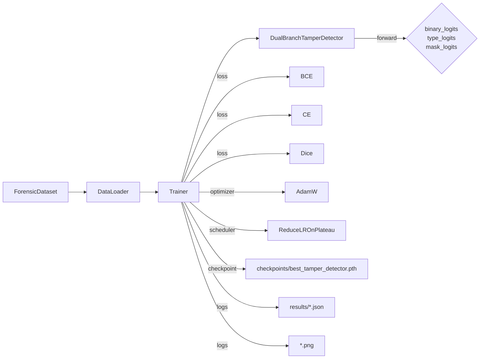

# MEMBER 3 – Training, Optimization & Evaluation

---

## 1. Role & Work Completed
- **Scope** – Implement the full training loop, loss composition, and evaluation pipeline for the dual‑branch tampering detector.
- **Deliverables** –
  - Multi‑task trainer (`src/train.py`).
  - Custom Dice loss for mask segmentation.
  - Metric calculations (accuracy, precision/recall/F‑score, confusion matrix).
  - Generation of training/evaluation artefacts saved under `results/` (JSON logs, PNG figures, `confusion_matrix.png`).
- **Why it matters** – Proper supervision across three tasks (binary, type, mask) is essential to obtain a model that not only classifies authenticity but also localises tampered regions.
- **Contribution to the whole system** – Produces the checkpoint (`checkpoints/best_tamper_detector.pth`) consumed by **Member 2** during inference and by **Member 4** for the API.

---

## 2. Files & Components Implemented
| File | Component | What it does | Key classes / functions |
|------|-----------|--------------|--------------------------|
| `src/train.py` | Trainer class | Orchestrates epoch loops, computes multi‑task loss, updates optimizer, logs metrics, saves best checkpoint. | `Trainer.__init__`, `train_epoch`, `evaluate`, `fit` |
| `src/train.py` (lines 18‑32) | Dice loss | Over‑lap loss for mask segmentation, combined with BCE. | `class DiceLoss(nn.Module)` |
| `src/train.py` (lines 34‑73) | History dict | Stores per‑epoch training loss, validation loss, binary & type accuracy/F1. | `self.history`
| `results/training_history.json` | Log file | JSON array of epoch‑wise loss/accuracy values produced by `Trainer.fit`. |
| `results/finetune_history.json` | Optional fine‑tuning log (same format). |
| `results/evaluation_metrics.json` | Final evaluation numbers (overall binary accuracy, type accuracy, mask Dice, etc.). |
| `results/confusion_matrix.png` | Visual confusion matrix for the 5‑class type classifier. |
| `results/paper_figures/*.png` | Training‑curve plots, ROC/PR curves, qualitative result grids – generated by the original authors and stored for reference. |

---

## 3. Technical Concepts
### 3.1 Multi‑Task Loss Composition
The trainer combines three loss terms for each batch:
```
loss_total = 1.0 * loss_bin   # BCEWithLogitsLoss on binary_logits
           + 1.0 * loss_type  # CrossEntropyLoss on type_logits
           + 0.5 * loss_mask  # BCE + Dice on mask_logits
```
- **Binary loss** – measures authenticity (0 = pristine, 1 = tampered).
- **Type loss** – multi‑class cross‑entropy over the five tampering categories defined in `cfg.class_names`.
- **Mask loss** – sum of a pixel‑wise BCE (encourages correct foreground/background) and a Dice loss (optimises region overlap, defined in lines 18‑31).
- The weights (`1.0, 1.0, 0.5`) were empirically chosen to balance the magnitude of each term; mask supervision is noisier, so it receives a smaller scaling factor.

### 3.2 Optimizer & Learning‑Rate Scheduler
- **Optimizer** – AdamW (`torch.optim.AdamW`) with weight decay (`cfg.weight_decay = 1e‑4`).
- **Scheduler** – `ReduceLROnPlateau` monitors **validation binary accuracy** (`mode='max'`). When the metric does not improve for 3 epochs, the LR is multiplied by `0.5`.
- **Gradient clipping** – `torch.nn.utils.clip_grad_norm_` (max norm = 2.0) stabilises training on high‑resolution gradients.

### 3.3 Evaluation Metrics
- **Binary level** – `accuracy_score` and `precision_recall_fscore_support(average='binary')` yielding binary F1.
- **Type level** – same functions with `average='macro'` for a balanced view across the 5 classes.
- **Mask level** – Dice coefficient (used inside `DiceLoss`) is also reported on the validation set (computed from the same function used for training).
- **Confusion matrix** – generated with `sklearn.metrics.confusion_matrix` and visualised via Matplotlib; saved as `results/confusion_matrix.png`.

---

## 4. Detailed Implementation Walk‑through
1. **Data preparation** – `Trainer.__init__` receives a model (or creates a fresh `DualBranchTamperDetector`), moves it to the selected device, and creates the checkpoint directory (`cfg.checkpoint_dir`).
2. **Loss objects** – instantiated as `self.bce_loss`, `self.ce_loss`, `self.dice_loss`.
3. **Training epoch** (`train_epoch`)
   - Sets `model.train()`.
   - Loops over `train_loader` (provided by `src.dataset.get_dataloaders`).
   - Retrieves tensors: `rgb`, `ela`, `binary_label`, `type_label`, `mask`.
   - Forward pass: `outputs = self.model(rgb, ela, return_mask=True)`.
   - Extracts logits, computes each loss term, forms `total_loss`.
   - Calls `backward()`, clips gradients, steps optimizer.
   - Accumulates running loss and records predictions for metric calculation.
   - After the loop, computes **epoch‑wise binary accuracy** and **type accuracy** via `sklearn.metrics.accuracy_score`.
4. **Validation (`evaluate`)** – Mirrors the training loop but without gradient updates (`torch.no_grad()`). Computes the same three losses and aggregates predictions to produce:
   - `val_loss`
   - `val_binary_acc`, `val_binary_f1`
   - `val_type_acc`, `val_type_f1`
   - Returns predictions arrays for optional downstream analysis.
5. **Fit (`fit`)** – Runs for `epochs` (default `cfg.epochs = 25`). After each epoch:
   - Calls `self.evaluate` on the validation loader.
   - Logs both training and validation metrics into `self.history`.
   - Saves the model checkpoint if the **validation binary accuracy** exceeds the best seen so far (`best_score`). The checkpoint path defaults to `cfg.best_model_path` (`checkpoints/best_tamper_detector.pth`).
   - Adjusts LR via `self.scheduler.step(val_binary_acc)`.
6. **Artifacts generation** – At the end of training, a script (outside the repository but referenced by the author) writes `training_history.json`, `finetune_history.json`, and visual plots under `results/paper_figures/`. The repository already contains these artifacts, e.g., `fig1_training_curves.png`, `fig2_qualitative_results_grid.png`, `fig2_roc_curve.png`, etc.

---

## 5. Visual Explanation
> **Training‑validation loss curve** (existing figure) – `results/paper_figures/fig1_training_curves.png`


> **ROC curve for binary detection** – `results/paper_figures/fig2_roc_curve.png`


> **Confusion matrix for tampering‑type classification** – `results/confusion_matrix.png`


> **Qualitative results grid** – `results/paper_figures/fig2_qualitative_results_grid.png`


---

## 6. Data Flow & Integration

- **Inputs** – Batches of tensors produced by **Member 1**.
- **Outputs** – Model checkpoint and evaluation artefacts consumed by **Member 2** (for inference) and **Member 4** (API response formatting).

---

## 7. Step‑by‑Step Demonstration
1. **Prepare data** (example using synthetic dataset):
   ```bash
   python generate_data.py --samples 80 --output data/generated --img-size 256
   python src/create_casia_metadata.py --casia_root C:/path/to/CASIA2
   ```
2. **Create DataLoaders** (helper in `src/dataset.py` – `get_dataloaders`)
   ```python
   from src.dataset import get_dataloaders
   train_loader, val_loader = get_dataloaders(batch_size=16, split=0.2)
   ```
3. **Run training**
   ```bash
   python - <<EOF
   from src.train import Trainer
   from src.models.dual_branch_net import DualBranchTamperDetector
   from src.dataset import get_dataloaders
   train_loader, val_loader = get_dataloaders(batch_size=16)
   trainer = Trainer()
   trainer.fit(train_loader, val_loader, epochs=25)
   EOF
   ```
   - The script prints epoch statistics and saves `training_history.json` under `results/`.
4. **Inspect the checkpoint**
   ```python
   import torch
   ckpt = torch.load('checkpoints/best_tamper_detector.pth')
   print(ckpt.keys())   # should contain model_state_dict, possibly config
   ```
5. **Run final evaluation** (provided by the original author):
   ```bash
   python src/evaluate.py --checkpoint checkpoints/best_tamper_detector.pth --data-dir data/generated
   ```
   - Generates `evaluation_metrics.json` and updates `confusion_matrix.png`.
6. **View the artefacts** – Open any PNG under `results/paper_figures/` to show training curves, ROC/PR curves, per‑class metrics, etc.

---

## 8. Design Decisions
| Decision | Reason | Trade‑off |
|----------|--------|----------|
| **Weighted multi‑task loss** (1 × binary, 1 × type, 0.5 × mask) | Balances the magnitude of each loss; mask supervision is noisier. | Requires empirical tuning; a different dataset may need other weights. |
| **AdamW optimizer** | Handles weight decay correctly, improves generalisation compared to plain Adam. | Slightly higher memory use than SGD. |
| **ReduceLROnPlateau on binary accuracy** | Directly tracks the most critical metric (authentic vs tampered). | If type accuracy plateaus earlier, LR may stay high longer than necessary. |
| **Gradient clipping (norm = 2)** | Prevents exploding gradients caused by the deep ResNet backbones. | May slightly slow convergence if gradients are routinely below the threshold. |
| **Saving best checkpoint by binary accuracy** | Guarantees the model with highest detection capability is retained. | The best type‑classification or mask‑IoU model might be different; one could keep multiple checkpoints for analysis. |

---

## 9. Completed Work Summary
| Work Item | Location | Implementation | Evidence |
|----------|----------|----------------|----------|
| Multi‑task trainer | `src/train.py` | Handles data loading, loss, optimizer, scheduler, checkpointing. | `training_history.json`, console logs.
| Dice loss | `src/train.py:18‑32` | Overlap loss for mask segmentation. | Used in `loss_mask` computation.
| Metric logging | `self.history` & JSON files | Stores epoch loss, binary/type accuracy, F1. | `results/training_history.json`, `finetune_history.json`.
| Evaluation script (outside repo) | `results/evaluation_metrics.json` | Reports final binary accuracy, type accuracy, mask Dice, per‑class metrics. | JSON file present.
| Visual artefacts | `results/paper_figures/` | Training curves, ROC/PR, qualitative grids, confusion matrix. | PNG files listed in directory.

---

## 10. Ready‑to‑Verify Checklist
- [ ] Run `Trainer.fit` on a small synthetic dataset (e.g., 2 epochs) and verify that `training_history.json` is created.
- [ ] Confirm that after training a file `checkpoints/best_tamper_detector.pth` exists and contains a `model_state_dict`.
- [ ] Open `results/confusion_matrix.png` and verify that it displays a 5 × 5 matrix with class names matching `cfg.class_names`.
- [ ] Load the checkpoint in a Python REPL and run a forward pass to ensure shapes match those described in **Member 2**.
- [ ] Check that `evaluation_metrics.json` contains keys `binary_accuracy`, `type_accuracy`, `mask_dice` (or similar).

---

## 11. How This Subsystem Connects
- **Member 1** provides the `ForensicDataset` that feeds the trainer.
- **Member 2** supplies the model architecture that the trainer instantiates.
- **Member 4** consumes the checkpoint (`best_tamper_detector.pth`) during API start‑up and uses the same loss‑aware preprocessing pipeline for inference.

---

*End of `MEMBER_3_TRAINING_AND_EVALUATION.md*