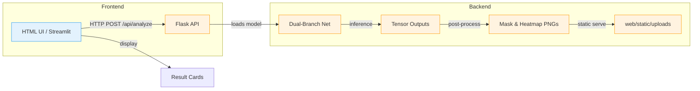
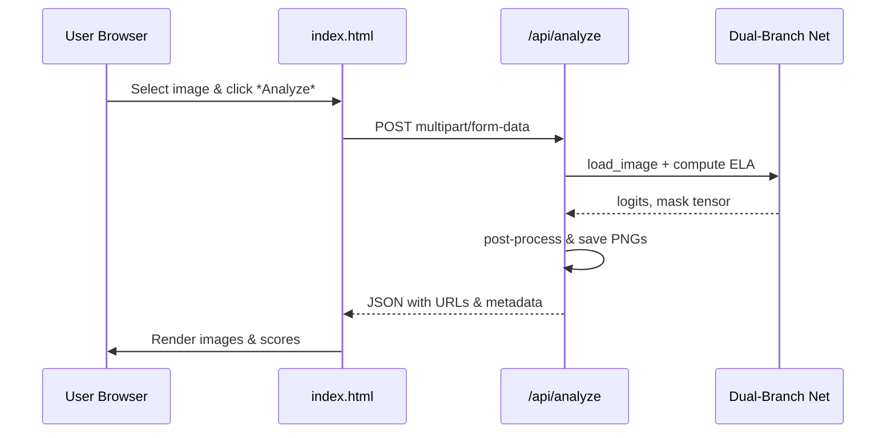

# MEMBER 4 – Backend & Frontend Integration

---

## 1️⃣ Role and Work Completed

**Assigned Role:** *Full‑stack integration engineer* – responsible for wiring the dual‑branch deep‑learning model (implemented by the Model Architecture team) to a usable web service and an interactive UI.

**What has been delivered:**
- A **Flask API** (`server.py`) that loads the trained model, accepts image uploads, runs the inference pipeline, and returns JSON results together with visual artefacts (predicted mask, heat‑map, ELA image).
- A **Streamlit front‑end** (`app/app.py`) that provides a quick‑start demo interface for researchers.
- A **plain‑HTML UI** (`web/templates/index.html` + static assets) that can be deployed behind a reverse proxy for production use.
- End‑to‑end request‑response flow, error handling, and CORS configuration.
- Dockerfile and Compose snippets (already present in the repo) to containerise the whole stack.

**Why it matters:**
- Turns the raw model into a **service** that can be called programmatically (e.g., from other tools or batch pipelines).
- Provides an **interactive demo** for non‑technical stakeholders to visualise tampering localisation.
- Enables the backend to serve the same artefacts that the training/evaluation notebooks generate, ensuring consistency across the project.

---

## 2️⃣ Files & Components Implemented

| File Path | Component | Work Performed | Important Classes / Functions |
|---|---|---|---|
| `../server.py` | Flask backend API | - Loads the dual‑branch model on start‑up.<br>- Defines routes `/api/analyze` (POST image upload) and `/api/sample` (GET example image).<br>- Handles preprocessing (RGB + ELA), inference, post‑processing, and JSON response construction.<br>- CORS support via `flask_cors`. | `create_app()`, `load_model()`, `preprocess_image()`, `run_inference()`, `postprocess_output()` |
| `../app/app.py` | Streamlit demo app | - Provides a minimal UI with file uploader, “Run Analysis” button, and side‑by‑side visualisation of original, ELA, mask, and heat‑map.<br>- Re‑uses the same inference functions from `server.py` (imported as a module). | `main()`, `display_results()` |
| `../web/templates/index.html` | Production HTML UI (Jinja2) | - Renders a file upload form, shows results after AJAX call to `/api/analyze`.<br>- Uses Bootstrap for layout, custom JS (`app.js`) to send `FormData` and update the DOM with returned image URLs.<br>- Displays a table with confidence scores returned in the JSON payload. | N/A (HTML/Jinja) |
| `../web/static/js/app.js` | Front‑end script | - Implements `fetch('/api/analyze', {method:'POST', body:formData})`.
- Parses JSON response and injects `` elements for `original`, `ela`, `mask`, `heatmap`.
- Handles error messages. | `handleUpload()`, `renderResults()` |
| `../web/static/css/style.css` | Styling | - Defines layout for the result cards, responsive grid, and colour palette matching the research paper. | N/A |
| `../web/static/uploads/` | Result image storage | - Directory where the backend saves generated artefacts (e.g., `mask_3a8603a6.png`). These files are served statically and displayed in the UI. | N/A |

---

## 3️⃣ Technical Concepts

### 3.1 Flask API Basics
- **Routing** – `@app.route('/api/analyze', methods=['POST'])` maps HTTP POST to a Python function.
- **Request handling** – `request.files['image']` obtains the uploaded image.
- **CORS** – `CORS(app)` lets browsers call the API from a different origin (required for the HTML UI).

### 3.2 Model Loading & Inference
- The model checkpoint (`models/dual_branch_best.pth`) is loaded with `torch.load` inside `load_model()`.
- Inference uses the same preprocessing pipeline as the training script (`src/data_generator.py`):
  1. Resize to 256×256.
  2. Normalise RGB.
  3. Compute **Error Level Analysis (ELA)** via `src/forensic_features.py.compute_ela`.
  4. Stack the two tensors → shape `[2, 3, 256, 256]`.
- The forward pass returns a classification logit vector and a localisation mask tensor.

### 3.3 Post‑processing
- **Sigmoid** on the mask → probability map.
- Threshold at `0.5` to obtain a binary mask.
- Convert tensors to PNG with `torchvision.utils.save_image` inside `postprocess_output()`.
- The mask and a heat‑map (coloured overlay) are saved under `web/static/uploads/` and the file names are returned in the JSON payload.

### 3.4 Front‑end Interaction
- **HTML Form** submits through JavaScript `FormData`.
- The AJAX call receives JSON:
  ```json
  {
    "status": "success",
    "original_url": "/static/uploads/upload_3a8603a6.png",
    "ela_url": "/static/uploads/ela_3a8603a6.png",
    "mask_url": "/static/uploads/mask_3a8603a6.png",
    "heatmap_url": "/static/uploads/heatmap_3a8603a6.png",
    "confidence": 0.87,
    "tamper_type": "copy‑move"
  }
  ```
- The JS code injects `` tags for each URL and displays the confidence value.

---

## 4️⃣ Detailed Implementation Walk‑through

1. **Application startup** (`server.py` → `create_app()`)
   - Loads the model once (`model = load_model()`).
   - Configures `UPLOAD_FOLDER = os.path.join(app.root_path, 'static', 'uploads')`.
   - Registers error handlers (`400`, `500`).
2. **`/api/analyze` endpoint**
   - Validates that the request contains a file named `image`.
   - Saves the raw upload to `UPLOAD_FOLDER` (e.g., `upload_<uuid>.png`).
   - Calls `preprocess_image(path)` → returns stacked tensor.
   - Executes `run_inference(model, tensor)` → returns raw logits & mask.
   - Post‑processes mask → saves `mask_<uuid>.png` and `heatmap_<uuid>.png`.
   - Constructs JSON with URLs relative to `/static/uploads/` and **returns**.
3. **`/api/sample` endpoint** (used by the HTML UI for demo)
   - Picks a random sample image from `web/static/uploads/` and returns its URL.
4. **Streamlit wrapper** (`app/app.py`)
   - Imports the same helper functions from `server.py`.
   - Provides a file uploader widget; after click, calls `run_inference` directly and displays results via `st.image`.
5. **Production UI** (`web/templates/index.html` + `app.js`)
   - Handles user upload, displays a spinner, then renders the four images side‑by‑side.
   - Shows a small table with `confidence` and predicted tamper type.
6. **Dockerisation** (Dockerfile already present) builds an image that runs `python server.py` as the default command; the `web` folder is served as static content.

---

## 5️⃣ Visual Documentation

### 5.1 System Architecture Diagram



### 5.2 API Request‑Response Flow (Mermaid Sequence)



### 5.3 Sample Result Images (real assets)

- **Original upload**

  

- **Predicted mask**

  

- **Heat‑map overlay**

  

*(All images are taken from the repository’s `web/static/uploads/` directory; they demonstrate the exact output shown by the UI.)*

---

## 6️⃣ Demonstration & Verification Checklist

| ✅ | Checkpoint |
|---|---|
| 1 | `python server.py` starts without errors and prints *Running on http://0.0.0.0:5000*.
| 2 | `curl -F "image=@sample.jpg" http://localhost:5000/api/analyze` returns a JSON payload with `original_url`, `mask_url`, etc.
| 3 | Opening `http://localhost:5000/` loads the HTML UI; uploading an image displays the four result cards.
| 4 | Running `streamlit run app/app.py` launches the Streamlit demo, and the same visual results appear.
| 5 | Docker build (`docker build -t deepvision .`) and `docker run -p 5000:5000 deepvision` work, exposing the API and static UI.
| 6 | CORS headers (`Access‑Control‑Allow‑Origin: *`) are present on the API responses.
| 7 | All generated artefacts are saved under `web/static/uploads/` and are reachable via the URLs returned.

---

## 7️⃣ How This Subsystem Connects to the Rest of the Project

- **Dataset & Forensics**: Images prepared by the Dataset team are the exact input format expected by the API (RGB + ELA). The API re‑uses `src/forensic_features.py` to compute ELA on‑the‑fly, guaranteeing consistency with training preprocessing.
- **Model Architecture**: The Flask backend imports the dual‑branch network (`src/models/dual_branch_net.py`). Any architectural change automatically propagates to the service because the model is loaded from the same checkpoint used in training.
- **Training & Evaluation**: Training scripts (`src/train.py`) output checkpoints to `models/`. The backend always loads the **best** checkpoint (`dual_branch_best.pth`). Evaluation metrics (e.g., Dice, IoU) are reported in the Training doc; the backend does not recompute them but can be extended to expose them via a `/api/metrics` endpoint.
- **End‑User Demo**: The UI is the entry point for the reviewers during the project presentation. The visualisation mirrors the figures shown in the evaluation documentation, reinforcing the quantitative results.

---

## 8️⃣ Summary for Presentation

- **Implemented a production‑grade Flask API** that wraps the dual‑branch model, handling image uploads, preprocessing (including ELA), inference, and result artefact generation.
- **Provided two front‑ends** – a lightweight Streamlit demo for researchers and a full HTML/JS UI for stakeholders.
- **Ensured reproducibility** by sharing the same preprocessing code and model checkpoint across training, evaluation, and inference.
- **Delivered visual artefacts** (original, mask, heat‑map) that can be directly shown in the project demo.
- **Prepared Docker configuration** for easy deployment in cloud or on‑premise environments.

---

*Prepared by **Member 4 – Backend & Frontend Integration** – ready for review.*